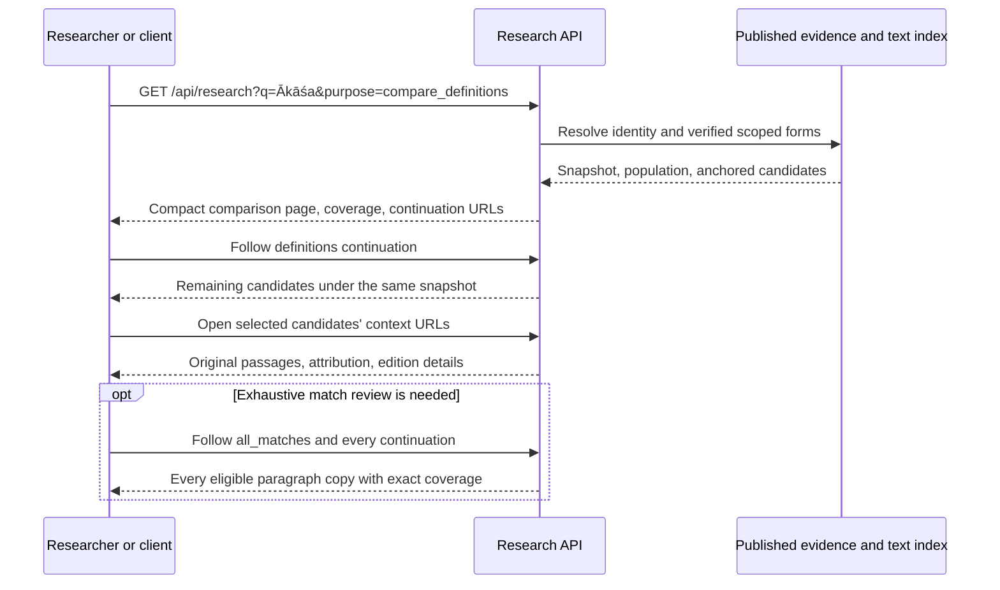

# Glosario API: definition research

Status: design complete; implementation proposed. Date: 2026-10-23.

Companion contract: [OpenAPI proposal](glosario-research-api.openapi.json).

## Objective and scope

Let a researcher compare exact definitions across authors, follow each quotation
to its context, and describe the extent of the search accurately. The default
output is evidence and citations. Selecting the clearest definition and composing
an article remain editorial work.

This design targets the public Glosario service in
`/Users/hans/Desktop/AI-Projects/GlossaryGen`. This document is kept beside the
existing Gnosis TMS research integration plans. It does not change application
code, corpus artifacts, production, or existing research runs.

Design work:

- [x] Inspect the public contract and representative research responses.
- [x] Inspect service retrieval, variant resolution, pagination, and sampling.
- [x] Inspect the Gnosis TMS clients and corpus-maintenance constraints.
- [x] Specify contracts, invariants, rollout, and acceptance criteria.

## Findings that determine the design

1. `serve_search.py:plan_search` already separates corpus-attested forms from
   source-specific forms. `GlossaryStore.source_spellings` currently recognizes
   selected reference layers; its comments explicitly exclude automatically
   treating Theosophical links as spelling equivalence. That exclusion protects
   against conceptual links and fragmented labels. Extend the reviewed mapping
   model; do not indiscriminately turn lookup aliases into search forms.
2. `/api/sample` deliberately searches explicitly supplied forms and supplies
   reproducible distinct-paragraph populations. Gnosis TMS relies on this for
   translation frequency research. Its literal counting semantics must remain.
3. `/api/search` paginates documents and returns at most three grouped passages per
   document. Finishing its pages does not mean receiving every matching paragraph.
   The inspected implementation ranks up to 2,000 rows; an exhaustive interface
   must not inherit that ceiling.
4. `/api/term` already returns a next-search-page link. The missing feature is a
   common coverage contract, not pagination itself. `/api/context` is explicitly a
   bounded translation packet.
5. Definitions, bibliographical annotations, source quotations, generated author
   summaries, and generation audit fields have different roles and response
   shapes. Presence in a curated collection does not prove human review.
6. Some indexed paragraphs contain multiple dictionary entries. Returning the
   entire paragraph obscures a short definition; returning only sentences that
   repeat the term loses explanations that use pronouns or omit the headword.

The live Akasha investigation exposed these problems, but observed counts such as
254 search hits and 378 distinct paragraphs belong to different query scopes and
publication filters. They are observations, not equivalent populations or fixed
acceptance counts. Local source inspection is not proof that the local revision
is identical to the deployed revision.

## Public interface

Add three GET endpoints. Keep existing endpoints and defaults compatible.

| Endpoint | Purpose | Default result unit |
| --- | --- | --- |
| `/api/research?q=Ākāśa&purpose=define` | Resolve the term; return a compact comparison page and coverage manifest | Definition candidate |
| `/api/research/definitions?term_id=c75.0.0` | Enumerate candidates with consistent provenance and citations | Definition candidate |
| `/api/research/matches?term_id=c75.0.0` | Enumerate every eligible matching paragraph under the same query plan | Paragraph copy |

The first endpoint is an orchestration wrapper over the same functions as the
other two, not another retrieval implementation. It embeds the first definitions
page; its continuation link goes to `/api/research/definitions`.

Reuse `/api/doc/{doc_id}/passages`, `/api/sample/context`, original-language
readers, and bibliographical readers for expansion. Return complete expansion
URLs rather than requiring clients to construct them.

### Query parameters

| Parameter | Contract |
| --- | --- |
| `q` | Human query. Resolves to a term where possible. |
| `term_id` | Authoritative term identity. If `q` resolves to a different term, return `400 query_term_mismatch`. |
| `match` | `term` or `literal`. Default `term` when a term resolves; otherwise `literal`. Effective value is always returned. |
| `forms` | Explicit comma-separated literal forms. Allowed only with `match=literal`; `q` and `forms` are mutually exclusive in literal mode. |
| `kind` | Existing values `all`, `samael`, `book`, `lecture`, `source`. Default `all` on the new endpoints. Invalid values return 400. |
| `normalization` | `casefold` or `folded`; default `folded`. Affects comparison only, never returned quotations. |
| `purpose` | Wrapper only: `define` or `compare_definitions`. Both use all authors unless overridden; comparison balances authors in its default ordering. |
| `order` | Definitions: `source` or `comparison`; matches: `source`. Default `comparison` for the wrapper and `source` for collection endpoints. |
| `limit` | Items per page, default 20, range 1–100. |
| `max_bytes` | UTF-8 JSON body budget, default 48,000 bytes, range 16,000–128,000. |
| `cursor` | Opaque continuation. Follow the complete returned `next` URL. |
| `include` | Optional `context`, `bibliography`, `audit`, or `originals`. Default compact metadata only. |

Unresolved `q` is a normal 200 literal search with `resolution.status=unresolved`;
it does not create a glossary identity. An explicitly unknown `term_id` returns
404. Ambiguous resolution returns alternatives without silently selecting one;
the collection is empty until the client selects a term or requests literal mode.

In term mode `q` identifies the concept; it does not automatically widen the
search to that string in every book. Literal mode is available explicitly.
Existing `/api/search` behavior is preserved.

### Response envelope

Every new response contains:

```text
api_version: "research-1"
snapshot_id: hash of the relevant published artifacts and algorithm versions
query_id: hash of snapshot + normalized effective retrieval specification
resolution: status, input, term_id, canonical_label, alternatives
query: effective match, scope, normalization, accepted forms and their scopes
coverage: matching population, candidate-discovery status, access exclusions
page: collection, order, returned, next, end_of_collection, content_complete, byte_limited
items: exact evidence records
sources: compact bibliography for sources used on this page
links: definitions, all_matches, query_manifest, documentation
```

`query_id` excludes pagination, response budget, ordering, and display includes.
It identifies the same underlying match population across endpoints. It includes
the requested source scope, matching policy, and effective spelling mappings.
Candidate generation and classification versions are separately identified in
`coverage.definition_detection` and included in the cursor fingerprint.

The shared snapshot includes search text, glossary identity data, verified form
mappings, source/edition metadata, passage segmentation, definition evidence,
publication policies, and retrieval/detection versions. Do not rely only on the
current search-database fingerprint when glossary or policy data can change
independently. A publication produces an immutable manifest of these components.

## One shared retrieval plan

Use an immutable `ResearchQueryPlan` with normalized parameters, global forms,
document-scoped forms, match predicates, publication eligibility, and snapshot.
Definitions, counts, paragraph enumeration, and expansion links share this plan.
Reuse existing FTS parsing, highlighting, and access-policy functions.

### Verified term spellings

Maintain a small, reviewed registry compiled into the published data:

```text
term_id, form, language, scope_type, scope_id,
relationship, evidence_spans[], review_status, review_receipt, evidence_hash
```

- `scope_type`: author or document. Existing Samael surfaces are author-scoped;
  a form verified in one reference book is document-scoped.
- `relationship`: spelling equivalence. Conceptual similarity, translation
  suggestions, and fuzzy candidates cannot automatically enter this registry.
- Source-specific forms require an exact attestation plus a judgment that they
  denote the term in that source. Mere occurrence is insufficient.
- Preserve literal text such as `Âkâza`; normalization is an explicit matching
  operation. Never correct a quotation to the canonical spelling.
- Preserve accepted/rejected/unresolved review receipts. Changed evidence or
  judgment rules invalidate affected records. No provider calls occur at request
  time and no per-term desktop author-verification work is introduced.

For Akasha, review Rama Prasad's `Âkâza` as a form in his book. Do not add every
parenthetical label from the Theosophical glossary globally. Do not silently
include nearby strings such as `Aksha` or `Anasha`.

`/api/sample?forms=...` continues to mean exactly the supplied forms. The new
matches endpoint supplies exhaustive semantic retrieval without changing that
research contract.

## Evidence records and definition discovery

A definition candidate has one structure regardless of author:

```text
evidence_id
unit: dictionary_entry | paragraph | passage
classification: definition | explanation | usage | uncertain
quote: exact text, text_hash, language, spans[]
spans[]: doc_id, line_id, start, end, paragraph_text_hash
attribution: document_author, attributed_speaker, translator, editor
provenance: collection, extraction_method, classification_method, review_status
selection_reason_codes[]
citation: source_id, chapter, paragraph, entry_headword,
          printed_page, pdf_page, page_validation_status, reader_url
links: context, full_evidence, original_witness, audit
```

All text offsets are Unicode code points, half-open, into the identified original
paragraph. Hashes must validate before slicing. Multiple spans support an exact
passage across paragraphs. Each span is a contiguous extract; omitted material is
explicitly represented rather than silently joined into a quotation.

`quote.joins` records how adjacent spans are displayed: `contiguous`,
`paragraph_boundary`, or `omission`. It has exactly one fewer member than spans,
or is empty for a descriptor. Contiguous joins use no separator, paragraph joins
use two newlines, and omissions use ` […] `. Reconstruct and validate `quote.text`
from these source slices and declared joins. This prevents selected fragments
from appearing to be a single continuous sentence.

`document_author` is not automatically the speaker of every passage. Preserve
embedded quotations and editorial additions. For example, Roviralta's bracketed
additions attributed to Hartmann or Rama Prasad must not be presented as direct
Blavatsky prose. Unknown attribution remains unknown. Existing edition and page
validation uncertainty remain visible.

Discovery combines:

1. Existing authorial definitions and source-level explicit-definition evidence.
2. Full dictionary entries linked through validated boundaries.
3. Deterministic candidates from the entire eligible match population: headword
   entries, copular definitions, and explanatory patterns. Negations, questions,
   hypothetical statements, and quoted speakers need separate treatment.

Generated summaries and paraphrases are not quotations. Existing annotations may
nominate candidates, but the API returns their source spans and records their
actual generation/review provenance. Unanchorable annotations are reported as
unresolved evidence and cannot supply quote text.

Rules nominate passages rather than deciding the best definition. A passage can
explain the term without using a pattern the detector recognizes. Return
`semantic_exhaustiveness="not_guaranteed"`, even after the detector examines all
matches. No `best_definition` field or synthetic numeric clarity score.

### Ordering

`order=source` is stable: source ID, document reading position, evidence ID.

`order=comparison` orders by evidence class and provenance of selection, then
interleaves author groups with deterministic ties. Preserve every candidate in
continuation pages; author balancing changes order, not eligibility. Anonymous
works use work identity. Human approval means provenance quality, not proof that
a definition is philosophically correct or clearer.

Return reason codes such as `dictionary_headword`, `explicit_definition`,
`explanatory_passage`, and `author_balance`. Allow scope changes for questions
about a particular author's usage. Do not force Samael-first ranking in a request
to compare all authors.

## Coverage and pagination

Keep independent measures. The following is an illustrative small fixture, not
the live Akasha population:

```json
{
  "coverage": {
    "population": {
      "paragraph_copies": 12,
      "distinct_paragraph_texts": 10,
      "documents": 4,
      "exact_within_query": true
    },
    "definition_detection": {
      "status": "current",
      "method_version": "definition-rules-1",
      "paragraph_copies_examined": 12,
      "candidates": 3,
      "semantic_exhaustiveness": "not_guaranteed"
    },
    "publication": {
      "status": "complete_for_eligible_material",
      "excluded_documents": 1,
      "excluded_match_count": null
    }
  },
  "page": {
    "collection": "definitions",
    "order": "comparison",
    "returned": 2,
    "next": "/api/research/definitions?cursor=EXAMPLE",
    "end_of_collection": false,
    "content_complete": true,
    "byte_limited": false
  }
}
```

Population counts are taken after the same scope, approved spellings, visible
text verification, and publication eligibility used for returned matches.
Paragraph copies are the enumeration unit; exact-text groups and their copy
counts remain available. Do not confuse occurrences with paragraph matches.
Only count excluded documents when the catalog permits disclosing that metadata;
excluded match counts remain null if unavailable or restricted.

Returning all three definition candidates would finish the candidates collection,
not the ten distinct paragraphs or the twelve paragraph copies. A client may say
it retrieved all eligible matches only after completing the matches collection.
It must track actual reading separately. The server never asserts that a human
or model has read its response or understood every definition.

Enumerate matches by `(doc_id, seq, line_id)` without a ranking cap. Index counts
and iteration use the same predicates. Large populations are paginated rather
than converted into a single unlimited response.

Cursors are stateless, opaque and integrity-protected. They bind snapshot,
effective query, collection, ordering/detector version, and last stable key.
Changing matching parameters while supplying a cursor returns 400. Changed
snapshots return `409 snapshot_changed` with a restart URL; expired/unavailable
snapshots return `410 snapshot_unavailable`. Do not silently continue against a
new corpus. Authorization/publication restrictions are rechecked on every page.

## Compact response and context

Use a page-local bibliography dictionary so each edition history is emitted once.
The compact bibliography includes author, title, edition label, and reader link.
Full histories and generation receipts require `include=bibliography,audit`.
Plain text and offsets are canonical; HTML highlighting is optional expansion.

Use `max_bytes` to stop only between evidence records. Never cut a quotation in
mid-sentence to satisfy a budget. If a whole entry is too large, emit a clearly
marked preview with `quote_complete=false` and a link to the full source evidence.
A preview is never presented as a complete definition. At least a descriptor fits
the minimum response budget, ensuring every cursor advances. `byte_limited=true`
explains why fewer than `limit` items were returned. Reserve room for envelope,
bibliography, and continuation metadata when enforcing the budget. Explicit
expansion uses the existing source/context endpoints and their own limits; the
compact page budget does not promise to bound a full reader response.

Compile dictionary-entry boundaries from reliable extraction markers. Validate
them against original paragraph text. Persist headword, entry spans, method,
review status, and content hash. When boundaries are unreliable, return the full
paragraph as an uncertain unit; never infer them by splitting on every period.
Include the complete definitional entry, including explanatory sentences that
do not repeat its headword. Existing paragraph links remain valid.

## Request workflow



The client can now report separately: candidates compared, exact entries read,
matches retrieved, surrounding context read, and remaining source restrictions.

`content_complete` means every item on this page contains its full requested text,
not just a descriptor or preview. Finishing enumeration while some items remain
previews establishes a complete inventory of matches, not complete text delivery.
Clients retain and expand those item IDs before claiming full-text coverage.

## Implementation boundaries

Within GlossaryGen, extract shared responsibilities from the existing service
without rewriting unrelated search/UI code:

| Area | Proposed responsibility |
| --- | --- |
| `serve_search.py` | Routing, admission control, existing public adapters |
| New `research_query.py` | Shared immutable query plan, policy eligibility, snapshot/query identities |
| New `research_evidence.py` | Registry reads, anchored candidate records, entry boundaries, provenance |
| New `research_api.py` | Compact serialization, coverage, stable ordering and continuation |
| Existing data-build workflow | Compile reviewed forms, entry boundaries, evidence index, artifact manifest |
| `search_ui/openapi.json`, AI guide, `llms.txt` | Document the new workflow and completeness vocabulary |

Reuse current reviewed definitions, original-language witnesses, source catalog,
and author-reference receipts. Compute deterministic discovery during builds or
incrementally for changed texts. Index published evidence by term and source.
An incomplete index exposes `definition_detection.status=partial` or `unavailable`;
it never represents missing classification as zero candidates. Matching and
enumeration remain usable. Unknown literal queries may use bounded deterministic
discovery at request time; if incomplete, return explicit examined/remaining
counts and link to full matches rather than starting a hidden background job.

Keep current search admission controls and `503 Retry-After`; no unbounded job or
LLM call is started from a GET request. No new AI credentials are required.

Gnosis TMS adoption is optional and later. Existing literal sample/population
calls, caches, and reports stay compatible. If adopted, add new paths to the Rust
corpus tool allowlist and normalize evidence through the existing adapters.
Do not change literal word-family counts merely because term research improves.

## Delivery sequence

1. Publish the shared snapshot and additive coverage vocabulary. Document existing
   endpoint scopes, document pagination, excerpt caps, and ranking limits.
2. Build the reviewed, document-scoped spelling registry and shared query plan.
   Use Akasha as a regression fixture while preserving source-scope isolation.
3. Normalize current definitions into anchored evidence records; add validated
   entry boundaries. Reuse existing receipts and preserve author/editor layers.
4. Add exhaustive matches and definitions collections, cursor consistency, body
   budgets, and comparison ordering. Add the research wrapper and documentation.
5. Run regression/contract checks, compare representative populations with the
   published artifacts, and then deploy code and matching data together under
   the existing publication procedure. Deployment is a separate execution task.
6. Consider Gnosis TMS adoption after the public contract is stable. Preserve
   paused acceptance studies and existing reports.

No new global alias is accepted merely to make an Akasha fixture pass. Corpus or
alias changes must follow GlossaryGen's maintenance and publication review rules.

## Acceptance criteria

- Resolved term, definition candidates, full matches, and context links use the
  same snapshot and effective forms. Term enumeration and explicit-form sampling
  agree only when their matching, document scopes, normalization, and policies
  are made identical.
- A reviewed `Âkâza` mapping finds the intended Rama Prasad evidence in that book;
  it does not add occurrences to unrelated authors. Fuzzy and conceptual aliases
  remain excluded. An actual review fixture supplies acceptance/rejection data.
- Existing literal `/api/sample` counts and seeded ordering remain unchanged.
  Existing source-specific Gurdjieff spelling/isolation tests continue to pass.
- A fixture with over 2,000 matching paragraphs and over three separated matches
  per document is fully enumerable exactly once, with no omissions, ranking cap,
  duplicate pages, or ambiguous page units.
- Counts reconcile under one query. Distinct texts, copies, occurrences, and
  candidates are tested separately. Restricted or unknown counts are not zero.
- A stale snapshot or changed detector/order cannot be combined with a current
  cursor. All response variants preserve citation and policy checks.
- Every quote validates exactly against its declared source spans, including
  accented and decomposed Unicode, supplementary characters, and multiline text.
  No fabricated page numbers, normalized quote spellings, or silent omissions.
- Dictionary-entry evidence includes explanatory sentences after the headword;
  neighboring entries and quoted speakers remain distinct. Uncertain segmentation
  is reported rather than fabricated.
- Comparison ordering includes every candidate over its pages and does not let a
  prolific author crowd out other authors on the first page. Reasons are exposed;
  completeness and clarity are never inferred from rank.
- Compact pages respect a 48,000-byte default body budget, advance even for a
  large evidence unit, and contain working links for every deferred field.
- Existing endpoints retain response fields and defaults. Original publication
  policies, edition identity, maintenance review receipts, source readiness,
  admission limits, and paused research runs are preserved.
- Every new response validates against typed OpenAPI schemas and documented
  error responses. End-to-end HTTP fixtures cover ambiguity, absent evidence,
  pagination, budget limits, invalid cursors, snapshot changes, and access policy.

## Scope limits

Complete enumeration means complete retrieval within the declared query and
available corpus. It does not mean every historical spelling is known, every
source is published, every definition has been detected, or every returned
passage has been read. These distinctions must survive into client reporting.

The highest-value first release is reviewed spelling coverage, compact unified
definitions, and explicit coverage. Semantic clustering, automatic article
generation, and model-scored clarity are outside this design.
