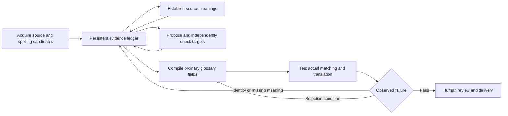

# Evidence-driven glossary research: system design and pilot

This is the implementation companion to `glossary-research-htn-design.md`. Production research is unchanged. Hans's latest requirement is a completely criteria-blind HTN, with human acceptance criteria confined to an external evaluator. The earlier laboratory trials in `runs/2026-10-14-htn` were requirement-aware and cannot establish this capability; they are retained as superseded diagnostics and cost records. A new isolated run must use raw source evidence only, without earlier inventories, proposals, notes, repairs, labels or candidate-use judgments.

## Boundary between HTN and acceptance evaluation

The HTN receives a source expression, languages, raw corpus/dictionary evidence and original-work witnesses. It establishes its own source meanings, candidates and quality checks. The acceptance file, expected renderings, per-word priority rules, test labels and grader verdicts are inaccessible to its research, self-check, counting and translation contexts. The compiler must not insert the acceptance criteria into notes. The external harness supplies those criteria only to evaluators after the candidate entry and translations have been frozen.

Human criteria can motivate general changes to schemas, evidence handling, source specificity, matching, conflict resolution or validation methods. They cannot become a word-to-answer lookup or be copied into runtime prompts. A fresh run after a design change remains blind. A failed hidden criterion is an observed external result, not permission to feed the answer to a repair agent.

Some human criteria can express project preferences that source evidence does not uniquely determine. Report those mismatches separately from meaning errors; do not pretend a blind system independently discovered a withheld preference. Legitimate original evidence is available, but human assertions about the required original, spelling or plural are not a substitute for that evidence.

## Organize around evidence that must survive

Use one persistent study record, with four operations: acquire evidence, establish source meanings, propose/check targets, and compile/test the delivered entry. The original full steps become obligations inside these operations, rather than a new mandatory model call for each instruction. An obligation has an evidence reference and a status: satisfied, inapplicable, pending, or unknown. A model's assertion of completion is insufficient.

The return arrows have a finite budget. They do not authorize repeating the entire research procedure. Transport retries, model research, translation tests and human review have separate limits and cost accounting. The production controller must enforce a study-wide budget that does not reset when an entry version changes. The corrected controller persists a study-wide limit of seven distinct research tasks and one repair round per word. Source refinement, target repair and final verification share that limit. Earlier requirement-aware debugging exceeded its nominal policy; those historical costs remain visible, separately from the corrected run.

The ledger stores:

- Source evidence with immutable document/location IDs, text, neighbors, edition and retrieval status.
- Each source form's evidence, relation and grammatical applicability. Retrieval similarity, semantic identity and approved inclusion are separate fields.
- Stable meaning IDs, definitions, grammatical roles, defining conditions and negative applicability conditions.
- Original designations, quotations, edition/language and provenance, including unresolved disagreement between witnesses.
- Every candidate's meaning IDs and kept/rejected/unknown disposition; source observations never disappear when a candidate changes.
- Proposed related studies, unresolved questions and evidence exposure. Human acceptance requirements are held outside this ledger.
- Versions and dependency signatures for the exact serialized entry, consumer, source context and model. External criteria/assessment signatures belong to the acceptance harness.

A source meaning is not deleted because a grouped presentation has fewer rows. A name's definition is not an alternative name. A modifier's contribution is not automatically a new meaning of its headword. Store constructions as applications of meanings, with exceptions, rather than permitting an unconditional construction rule to override source interpretation.

## Acquisition, including successful searches

Always discover alternate forms for a single-word study, including when exact results exist. The separate GlossaryGen chat implements this using the existing SQLite search service. It returns candidates with exact, lemma, typo or derivation evidence and scoped counts. No Elasticsearch infrastructure migration is required by that implementation.

Keep three operations separate:

1. Retrieve candidates broadly enough to expose alternate spellings.
2. Confirm contextual identity, distinguishing related derivatives, inflections, names and unrelated look-alikes.
3. Retrieve and count exact verified forms, deduplicating paragraph and occurrence identities.

Do not silently add fuzzy candidates to counts or translation matching. Conversely, do not let nonzero exact hits clear the recall obligation. Pagination, candidate limits and incompleteness must be visible. No finite fuzzy search proves every possible spelling has been found.

The earlier pilot recovered 187 author paragraphs for the Hasnamuss family. The corrected blind acquisition calls the new local candidate-discovery endpoint even when exact matches exist. The service change is implemented and tested in the separate chat; hosted deployment remains pending.

## Conditional work, with completion evidence

Dictionary status and independent source interpretation are always recorded. Deeper original-book work activates when a naming, borrowing, unexplained meaning or independently identified provenance question needs it. Parts/familiarity studies activate for constructed words, false friends or an actual claim about reader familiarity. Shared-glossary semantic checks activate after a cheap collision lookup finds a relevant collision. Related derivatives become proposed studies rather than automatic recursive research.

Original verification can sometimes use an existing deterministic proof. Hooltanpanas meets the narrow original-edition/numeric-unit identity test. Similar spelling alone cannot use this shortcut. Hasnamuss requires semantic evidence; the inspected English and German witnesses use different plural forms. The runtime must resolve or report that disagreement from evidence. The externally prescribed plural is an acceptance criterion only.

The target proposal should receive a compact evidence projection containing the actual cited witnesses for every supported meaning, including the rare ones. A fixed “first 12/18 paragraphs” slice can omit the passage that establishes a defining condition. The pilot exposed that limitation: some generated notes describe evidence as unavailable even though its ID exists elsewhere in the study. The production packet builder must retrieve those referenced witnesses; omitting them to save tokens is not a validated optimization.

Candidate checks use the same ledger projection but an independent reading instruction. They check every proposed candidate, not a representative presumed interchangeable. Group identical target text for display only when all underlying meaning/applicability links remain inspectable. Reject missing meaning coverage mechanically before asking a model to review it.

## Compilation is a correctness boundary

The compiler owns verified source forms, target inflections, meaning coverage and field placement. The proposal model cannot invent searchable aliases. General provenance goes into general translator notes; usage conditions go beside the actual target choices. Reader explanations are separate from research uncertainty and should not become invented translation content.

The HTN's source-derived wording and applicability must survive the actual matcher and hint builder. A verified plural must be an available target, not merely a sentence in the report. Derived forms need their own interpretation or a specifically verified shared treatment. An original English designation must not silently become a Spanish alias. The acceptance harness separately checks human-required wording without passing it into compilation.

Selection must start with the word's meaning in the supplied source neighborhood. A construction's usual association cannot defeat a different lexical meaning established in that occurrence. The fatal triangle case shows that preserving both targets and adding “human requirements override” is insufficient. The pilot therefore tests one generic selection contract separately, without another research stage or a triangle-specific phrase entry. Its result is a post-confirmation diagnostic because the failure was already exposed.

Word mention needs separate applicability: a pronunciation/spelling example is evidence about a string, whereas an ordinary name denotes the concept. The Hasnamuss test detected damage to a J-pronunciation example. This remains a delivery failure in the benchmark; the design calls for preserving metalinguistic content while canonicalizing concept references. It does not justify silently correcting a quoted pronunciation instruction.

Hans authorized a final app check that can patch individual usage notes or ordering, provided its agent does not know the acceptance rubric. Earlier v7 blinded this agent but gave it an entry built with the rubric; that does not satisfy the later clarification. In the corrected system both the entry's construction and the final check are criteria-blind. The compiler permits only source-quoted note edits and a permutation preserving every candidate; forms, target text, provenance and reader notes are preserved. A missing meaning/candidate routes to the appropriate source/target task within the same finite repair budget, rather than being disguised as a note patch. This is one proposal, then separate acceptance testing, not an unlimited self-repair loop.

The generic context-before-construction contract belongs once in shared consumer instructions, rather than being invented for each term. Individual term edits are source-supported proposals from a fresh criteria-blind agent. No requirement-aware candidate or guidance is imported into the corrected run.

Served variants are sorted by measured preferred-use frequency, most frequent first, and the translator is explicitly told this. An independent seeded source sample excludes acceptance IDs/normalized texts except unavoidable sparse overlap. Two independent candidate-selection judgments account for every matched occurrence. Disagreements, ambiguity and unassigned choices are excluded from confirmed counts and remain visible; zero-count rare branches are retained. Identical literal targets aggregate counts without deleting their applicability notes. Source-derived applicability is separate from frequency. Sample counts are not exhaustive corpus prevalence or a correctness score.

## Test the intended error, then test the tool

The seven human-specified terms are the acceptance cohort. Use genuine source paragraphs, source-only interpretation before seeing trial outputs, development and reserved confirmation roles, and identical neighboring context for every translation arm. The primary control is no glossary. A human-hints-only arm distinguishes the benefit of supplied requirements from additional research.

For each mechanism, inject its specific mistake and provide a legitimate alternative as a negative control. The pilot's evaluator passes 44 mirrored domain presentations and two mirrored wrong-number presentations. Pure tests separately detect dropped meanings, fabricated evidence IDs, missing aliases, lost plural/provenance/notes, stale identities, substring matching and schema corruption. These demonstrate sensitivity to those faults; they do not establish human correctness or all original-procedure equivalence.

| Term | Failure the cases are designed to expose |
|---|---|
| mundo | Planet remains unavailable or under-selected; planet is over-applied to realms, society, idioms or a category containing the Sun. |
| sensible | Reasonable replaces perceptible; sensory and affective/feeling functions collapse; genuine related studies are omitted. |
| vanidad | Vietnamese loses concern about appearance/public image/others' judgment; the requirement is forced onto a genuine futility reading. |
| Hooltanpanas | Misspelling survives, an alias fails to match, origin disappears, definition replaces name or a number changes. |
| Hasnamuss | Attested spellings fail to match, canonical plural disappears, noun/derivative applicability is unresolved or pronunciation text is damaged. |
| fatal | Harm/evil/fate becomes death, or a real death case is weakened by a generic construction note; rare branches disappear. |
| Íntimo | Required noun designation/origin disappears or ordinary inner/private usage becomes a divine name. |

Score meaning, project terminology, naturalness and whole-passage preservation separately. Both sides can be wrong; that is zero improvement. Repeat claimed gains and harms with independently ordered assessment. Record disagreement and ambiguity rather than converting either to a win. These are provisional model judgments under human-supplied criteria; human review remains necessary for contested linguistic conclusions.

Sparse or exposed cases cannot prove fresh confirmation. Both Hooltanpanas paragraphs were research-exposed. One fatal confirmation paragraph duplicates research after punctuation normalization. The historical Sun boundary and post-failure selection diagnostic are explicitly exposed checks. Near-duplicates cannot inflate independent evidence.

## Efficiency changes that can be defended

Reuse exact evidence and judgments by dependency signature; send only required witnesses to a task; keep static instructions cacheable; assemble forms, coverage, field placement, accounting and reports in code. Keep candidate and scope history in the ledger without copying the whole history into every translator prompt. Independent acquisition can run concurrently; original verification, review and version-dependent assessment retain their dependencies.

Avoid a separate normalization call merely to make an inventory look smaller. It must not replace the underlying source meanings. Prefer one source interpretation with meaning/construction separation in its schema. A generic compiler/consumer rule belongs once in a shared contract, not repeatedly as per-word research. These are proposed production optimizations, not measured savings from this pilot.

The pilot includes all failed and superseded attempts, unknown token usage and runtime overhead. Imported source evidence is not free and is not yet fully attributed. Throttling and timeouts prevent a clean speed comparison. No cost or speed win is claimed. Cold matched-purpose runs against the original full system are still required.

## Adoption decision

### Candidate delivery and ordinary selection update (2026-10-15)

The scoped fix in `runs/2026-10-14-candidate-delivery/RESULTS.md` restores an
obligation weakened by the first prototype. Target generation retains useful
context-scoped candidates even when a broad target covers the lexical meaning.
Audit findings become source-quoted delivery obligations; the compiler verifies
actual target text and usable scope, not a prose acknowledgment. Kept dispositions
cannot silently disappear. These checks also run after frequency sorting, retaining
zero-count supported variants. One conditional closure attempt handles detected
delivery defects; remaining failures block certification and appear in the report.

Candidate validity and selection preference are separate. For a preferred narrower
candidate, translator-facing notes must state a positive conditional selection
priority over broader defaults and measured frequency, with appropriate fallback
conditions. Mere applicability does not establish preference. Source witness IDs
belong in research evidence rather than serving as selection keys in notes.
An actual-selection check during glossary construction can route unavailable
targets back to candidate work and available-but-underused targets to note/priority
repair. Recheck the resulting entry with ordinary translation; this does not impose
a separate source-analysis call on every production translation.

The criteria-blind repair produced planet and planets. Across 43 paragraphs / 57
occurrences, two repetitions and independently ordered external judges confirm
seven repeated terminology improvements over both ordinary no-glossary translation
and the old deficient entry. No researched-term meaning or policy harm was confirmed
across 86 presentations. Six detector fault/acceptable-alternative controls and ten
external controls pass. The original planetary cases therefore support a glossary
fix, rather than requiring the extra application-time reasoning workflow.

Do not infer unconditional reliability from that result. A fresh-ID/new-planet-name
variant selects worlds in one of two repetitions; its stability remains unresolved
after the consumer repair limit. Eight source preferences remain unknown per
repetition. An unrelated whole-passage regression is also recorded. The terminal
selection status is needs-review. Research context and note generality may matter;
the cause is unestablished. These failures remain visible, and neither this scoped
pilot nor its successful old-case results authorizes retiring the full safeguards.

Keep the full procedure available. None of its twenty safeguard contracts is retired by the seven-term pilot. Full frequency/counting semantics, shared-glossary contrasts, the broader historical and random regression cohort, actual configured application-model behavior, human review and a matched cold-run efficiency comparison remain adoption gates. A regression in a minority meaning blocks adoption even when aggregate wins are positive.

This design replaces the habit of adding a universal research step after every bad word with identifying which evidence or delivery obligation failed. The pilot's defects and improvements remain in the results. Production integration should proceed only for mechanisms whose acceptance cases, actual consumer behavior and required review have been completed.

## Mundo feasibility and source-specific preference (2026-10-14)

**Comparator correction:** the experimental glossary used below omitted planet
despite the independent audit recognizing its contextual validity. Repair changed
the explanation but kept the candidate rejected, and compilation did not check
that this finding was resolved in delivered targets. This is an audit-to-delivery
failure and a regression in candidate preservation. The comparison is evidence
about that deficient entry, not grounds to favor a translation-workflow change over
a corrected glossary. See `plans/glossary-research-mundo-candidate-omission.md`.
Require scoped candidate coverage and explicit audit resolution within existing
target/audit/compiler stages; do not add a new research stage for an error the
existing audit already found. Test the repaired entry in ordinary translation.

The isolated probe in `scripts/glossary-research-lab/runs/2026-10-14-meaning-binding/RESULTS.md`
keeps per-word human criteria outside every model call. Two unprimed source readings
independently prefer planet for five clear occurrences where the baseline uses world.
Both avoid narrowing the category containing the Sun to planets. Fresh reviews of
existing translations often accept world as best/equivalent. The observed problem
is not an inability to understand the physical referent; the preferred rendering
can disappear when a later task accepts a broader synonym.

The source-only meaning list overlaps Earth/globe and planetary uses. A source-only
refinement merges these into a broad meaning, also covering the Moon and Sun. Both
mapping judges prefer world for that broad meaning. Thus a single preferred target
per lexical meaning does not retain context-specific preferred wording. A mechanical
check can pass while enforcing an insufficiently specific mapping.

The probe proposes extending the ledger with source-specific rendering preferences and their supporting
context/application, separate from lexical meanings and candidate validity. Establish
the preference before presenting an existing translation or candidate list. Preserve
its evidence, applicability and target identity through compilation and consumer
checks. Later acceptance of a synonym cannot silently erase the earlier preference.
When the selected application has an agreed preferred target, bind that identity and
verify its actual rendered span and source-occurrence accounting deterministically.
Frequency controls presentation order; source applicability and preferred binding
control selection. A disputed preference is unknown and cannot borrow another
occurrence's target through their shared broader meaning.

The probe preserves five independently chosen planet renderings and the Sun boundary
in actual translation. Its final mechanical check passes on 12/25 paragraphs, 16/34
occurrences. Unserved cases remain unknown. The initial routing defect was detected
by the checker, preserved, fixed with a generic eligibility gate and retested. Six
fault injections into actual outputs and eight pure binding/routing tests pass.
These repeated calls establish feasibility, not a mandatory thirteen/fourteen-step
research procedure; the fields and checks belong inside existing source, target and
consumer methods.

The subsequent matched comparison is complete in
`scripts/glossary-research-lab/runs/2026-10-14-equal-compute/RESULTS.md`.
Across all 25 paragraphs, with two independent repetitions, the higher-reasoning
no-glossary workflow matched glossary meaning and terminology at a similar total-token
budget (109,164 versus 113,043). No glossary quality gain repeated across both
repetitions. The second glossary repetition also failed its literal contract checks;
that failure remains recorded. Human criteria were external to all workflows.

Production adoption of the proposed extension remains unvalidated. It is not
rejected or removed by this comparison: both workflows used source-first analysis,
preserved preferences and deterministic checks, so their incremental benefit was
not isolated. The result concerns the added value of researched glossary information
within that shared workflow. The probe establishes source-first reasoning
feasibility, without demonstrating additional glossary quality beyond that reasoning.
Hans accepts additional compute within reason for demonstrated quality improvements;
matching compute is an experimental control, not a ceiling on the design.
This small, previously exposed English cohort does not establish future-word
reliability, general glossary equivalence, speed savings or human validation. The
broader seven-term application benchmark remains stopped; all criteria-blind research
records and costs are retained.
